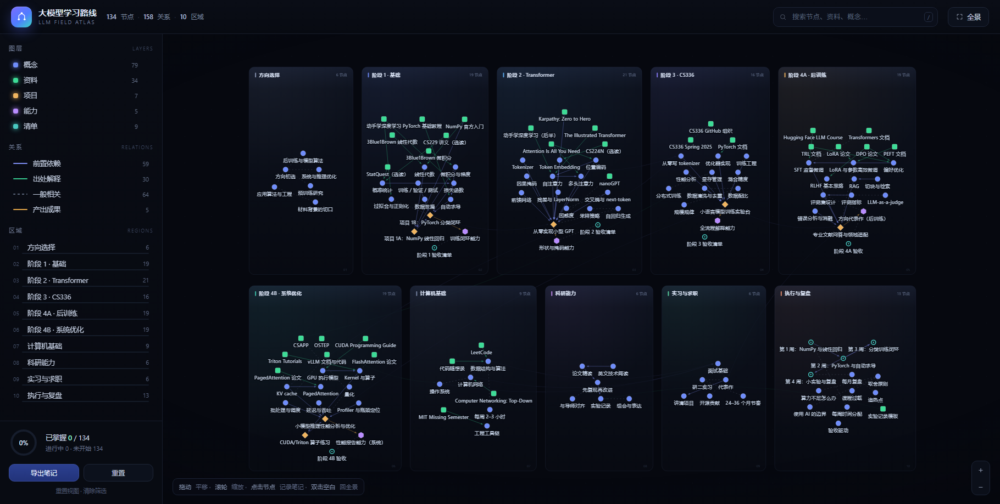

> 在 Obsidian 中查看：在左侧文件列表右键 `大模型学习路线-交互图谱.html` →「在默认应用中打开」，或直接在资源管理器里双击。
>
> 这个 HTML 要和同目录的 `mathjax-tex-svg.js` 放在一起，笔记里的公式才能渲染。

# 大模型学习路线 · 知识图谱

把 `大模型学习路线-跨专业研一到就业.md` 整理成一张可交互的知识地图：**134 个节点 · 158 条关系 · 10 个区域**，覆盖文档里的方向选择、五个学习阶段、计算机基础、科研、求职与执行清单。



## 打开

双击 `大模型学习路线-交互图谱.html`，推荐 Chrome / Edge。

文件夹里的两个文件要放在一起：

- `大模型学习路线-交互图谱.html`：图谱本体
- `mathjax-tex-svg.js`：本地公式渲染器，用来显示笔记里的 LaTeX（没有它时公式会退回源码显示）

不需要联网，不需要在页面里安装任何东西。窗口宽度建议 ≥ 1280px。

笔记会自动备份回这个文件夹（停笔约 1 秒后写盘），详见下文「自动备份怎么工作」；如果侧栏底部显示「自动备份未连接」，双击 `启动自动备份.command` 即可。

## 操作

| 操作 | 效果 |
| --- | --- |
| 拖动空白处 | 平移画布 |
| 滚轮 | 以鼠标为中心缩放 |
| 点击节点 | 右侧打开详情：说明、要点、资料链接、关联节点、笔记、学习状态 |
| 搜索框 / `/` | 按标题、描述、标签搜索，回车跳到节点 |
| 左侧图层 | 显示/隐藏 概念、资料、项目、能力、清单 |
| 左侧关系 | 显示/隐藏 前置依赖、出处解释、一般相关、产出成果 |
| 左侧区域 | 点击飞到对应板块（也显示各区域的掌握进度条） |
| 双击区域 | 放大到该区域；双击空白回全景 |
| `F` / 右上「全景」 | 回到全局视图 |

节点形状对应类型：圆点 = 概念，方块 = 资料，菱形 = 项目，六边形 = 能力，圆环 = 清单。
节点右上角的蓝点表示写过笔记；绿色圆环 = 已掌握，橙色半环 = 学习中。

## 笔记：支持 Markdown、代码和公式

节点详情里的「我的笔记」有 **编辑 / 预览** 两个页签：编辑时写 Markdown 原文，切到预览看排版。

### 支持的写法

| 要写的东西 | 这样写 | 说明 |
| --- | --- | --- |
| 标题 | `## 标题`、`### 小标题` | `#`～`######` 都行，面板里自动降一级显示 |
| 粗体 | `**重点**` 或 `__重点__` | 全角 `＊＊重点＊＊` 也识别 |
| 斜体 | `*强调*` | 不建议用 `_强调_`；全角 `＊强调＊` 也识别 |
| 删除线 | `~~作废~~` | 全角 `～～作废～～`、`〜〜作废〜〜` 也识别（中文输入法容易打出全角） |
| 行内代码 | `` `scores.masked_fill(...)` `` | 反引号包住 |
| 代码块 | 三个反引号开头，可写语言名 | 见下面示例，支持自动换行 |
| 无序列表 | `- 条目` 或 `* 条目` | 支持一层，暂不做嵌套 |
| 有序列表 | `1. 条目`、`2. 条目` | |
| 勾选清单 | `- [ ] 未完成`、`- [x] 已完成` | 预览里显示成复选框 |
| 引用 | `> 一句话` | |
| 链接 | `[文字](https://example.com)` | 只允许 http(s)、mailto、站内锚点 |
| 图片 | `` | 网络图片，或相对于 HTML 文件的路径 |
| 表格 | 见下面示例 | 支持 `:---` 左对齐、`:--:` 居中、`---:` 右对齐 |
| 分隔线 | `---` | |
| 行内公式 | `$QK^T/\sqrt{d_k}$` 或 `\(...\)` | |
| 块级公式 | `$$\mathrm{softmax}(QK^\top/\sqrt{d_k})V$$` 或 `\[...\]` | 单独一行，居中显示 |
| 换行 | 直接回车 | 同一段里回车会换行；空一行分新段 |

表格和代码块示例：

````markdown
| 方法 | 显存 | 备注 |
| --- | :--: | ---: |
| LoRA | 低 | **推荐** |
| 全参 | 高 | `A100 80G` |

```python
scores = q @ k.T / math.sqrt(d_k)
scores = scores.masked_fill(mask == 0, -1e9)
```
````

公式由本地的 `mathjax-tex-svg.js` 渲染成 SVG，离线可用。用的是完整版 TeX 扩展，`\boldsymbol`、`\tag`、`bmatrix`、`\mathbb` 这些都能正常显示；特别宽的公式会自动缩放到面板宽度。面板右上角的 ⤢ 可以把面板放大到 720px，编辑框右下角也能拖动加高，长笔记更好写。

### 暂不支持

- 列表嵌套（缩进子列表会当普通段落）
- 脚注、目录、HTML 标签、Obsidian 的 `[[双链]]` 和 `![[图片]]` 语法
- 任务清单只读，预览里不能直接勾选（回编辑里改 `[x]`）

导出时保留的是你写的 Markdown / LaTeX 原文，所以导进 Obsidian 后能继续正常渲染。

## 笔记存在哪里

笔记和学习状态以浏览器本地（localStorage）为准，只在这台电脑、这个浏览器里有效；同时**自动备份**会把同样的内容实时写回这个文件夹，Obsidian 里随时能读到。

**容量**：单条笔记没有字数限制，限制来自浏览器的 localStorage 配额——Chrome/Edge 大约 5–10 MB，Safari 大约 5 MB，按 UTF-16 计算约合 **250–500 万汉字**（所有节点共用）。侧栏底部会实时显示「本地笔记 N 条 · 约 X KB」；普通文字笔记很难写到上限，真正的风险是清理浏览器数据或换浏览器导致丢失。

- **自动备份**（默认开启）：停笔约 1 秒后，把每条笔记分别写进本文件夹的 `节点笔记/<节点名>.md`，同时更新 `大模型学习路线-笔记总览.md` 和 `大模型学习路线-笔记备份.json`，Obsidian 里立刻能看到更新，不用再点「导出」。
- **导出笔记**：下载一份合并版 Markdown（所有节点笔记串成一篇，方便分享或搬到别处）；库里仍然是一条笔记一个文件。
- **备份 / 导入**：把全部笔记和进度导出成 JSON，在新设备上导入即可完整恢复（连状态和原文一起搬）。
- **重置**：清空全部状态和笔记（会二次确认）。

换电脑、换浏览器、清理浏览器数据都会丢失浏览器里的记录，那时用「备份 → 导入」搬；文件夹里的 md / json 是给你在 Obsidian 里读和留底的。

## 自动备份怎么工作

侧栏底部有一行状态：

| 显示 | 含义 |
| --- | --- |
| 🟢 自动备份 · 已保存 14:22:31 | 正常，最近一次已写进文件夹 |
| 🟡 自动备份未连接 · 点此重试 | 后台服务没运行，点这行或双击 `启动自动备份.command` |
| 🔴 自动备份出错 · 点此重试 | 写入被拒绝或目录不可写，看 `~/Library/Application Support/LLMAtlasAutoSave/autosave.log` |

写入的文件：

- `大模型学习路线-笔记总览.md`：进度概览，每个有内容的节点一行，链接直达它的笔记
- `节点笔记/<节点名>.md`：**一条笔记一个文件**，写什么、何时改，只影响它自己（可以在 Obsidian 里直接改，会同步回网页，见下）
- `大模型学习路线-笔记备份.json`：同一时刻的全量 JSON 备份，「导入」用的就是它
- `自动备份/快照-年月日.json`：每天一份 JSON 快照，保留最近 60 份
- `自动备份/回收站/时间/`：某条笔记被清空后，它的 md 会挪到这里（不直接删）

公式：笔记里用 `\[ … \]`、`\( … \)` 写都可以，导出到 md 时会自动转成 Obsidian 认的 `$$ … $$` / `$ … $`（页面预览本来就两种都支持，所以你在网页里看到的公式效果和 Obsidian 里一致）。

单条笔记的结构：

```markdown
---
title: "动手学深度学习"
type: 资料
region: "阶段 1 · 基础"
status: 学习中
node: r-d2l
updated: 2026-11-11
tags:
  - 知识图谱笔记
---

# 1. 引言
（你写的正文，原样照抄，标题层级不动）
```

文件名按节点名生成，`/ : * ? " < > |` 这类字符会换成空格（比如「训练 / 验证 / 测试」→「训练 验证 测试.md」），总览里的链接已经按同一规则写好，点进去就是对应文件。

这些 md 会自动维护：在 Obsidian 里改正文会同步回网页（见下一节）；笔记清空后对应文件会进回收站，不会丢在意料之外的地方。

## 在 Obsidian 里改笔记（双向同步）

`节点笔记/*.md` 可以直接在 Obsidian 里改。保存后回到网页（切回标签页、点一下窗口都行），页面会提示「已从 Obsidian 同步 N 条修改」，并把正文读回编辑器；网页下一次保存前也会先检查文件是不是被外部改过，发现就先合并再写，两边不会互相覆盖。

会同步的：

- 正文（Markdown、公式、代码块、图片全部原样）
- frontmatter 里的 `status`：`已掌握` / `学习中` / `未开始`

同步只看「正文 + status」：Obsidian 或插件自动改写的 `created` / `updated` 这类 frontmatter 字段不会触发同步，也不会被当成错误。
如果你正在网页里写某一条笔记，而 Obsidian 那边也改了同一条，以网页里的为准，避免边写边被替换。

不会同步的：

- `title` / `type` / `region` / `updated` 这几个字段，下次自动备份会按网页里的数据重新生成；你自己加的 frontmatter 字段也会被覆盖
- **不要删文件**：删掉 `节点笔记/xxx.md` 不会删掉网页里的笔记，下次保存会把文件重新写出来；想清空就清空正文

原理：一个只监听 `127.0.0.1:8765` 的 Python 小服务（由 launchd 开机自启，安装位置 `~/Library/Application Support/LLMAtlasAutoSave/`）接收页面发来的 Markdown / JSON，校验后原子写入。页面本身仍是 `file://` 打开的静态文件，笔记继续存在浏览器里，不联网、不上传。

**停用自动备份**

```bash
launchctl bootout gui/$(id -u)/local.llmatlas.autosave
rm ~/Library/LaunchAgents/local.llmatlas.autosave.plist
mv ~/Library/Application\ Support/LLMAtlasAutoSave ~/.Trash/
```

**服务没起来时**：双击文件夹里的 `启动自动备份.command`（会在终端里重启服务并打印状态），再回页面点一下状态行即可。

## 迁移到新电脑（以 Mac 为例）

文件同步和笔记迁移是两件事：HTML 文件夹跟着 Obsidian 库 / 网盘走，笔记要单独「备份 → 导入」。

**旧电脑上**

1. 用最新版打开图谱，看侧栏底部「本地笔记 N 条 · 约 X KB」，确认要搬的数据量；
2. 点侧栏底部「备份」，浏览器会下载 `大模型学习路线-笔记备份-日期.json`；
3. 想要一份能直接读的副本，再点「导出笔记」生成 Markdown；
4. 把整个 `大模型学习路线-交互图谱` 文件夹（HTML + `mathjax-tex-svg.js` + 说明 + 预览图）和备份 JSON 一起传到 Mac：AirDrop、iCloud 云盘、U 盘、邮件都行。

**新电脑上**

1. 把文件夹放进 Mac 的 Obsidian 库（或任意目录），双击 HTML，用 Chrome 或 Safari 打开；
2. 点侧栏底部「导入」，选那个 JSON；出现「已导入 N 条记录」、底部变成「本地笔记 N 条」就成功了；
3. 随便打开一个节点，确认笔记内容和「已掌握 / 学习中」状态都在，公式能正常渲染；
4. 以后换浏览器、换网址、重装系统，都重复「备份 → 导入」。

**注意**

- 笔记跟浏览器和访问地址绑定：同一台 Mac 上换 Safari/Chrome，或从本地文件改成网址访问，都要重新导入一次；
- 备份 JSON 是明文，含你的笔记内容，别随手发到公开地方；
- HTML 和 `mathjax-tex-svg.js` 必须放在同一目录，缺了公式会退回源码显示；
- 手机浏览器也能用：左上角 ☰ 打开图层和区域，双指缩放，点节点看笔记。
- 如果文件夹在 Obsidian 库里且用 iCloud / Obsidian Sync，文件会自动出现在 Mac 上，但**笔记仍然要按上面的步骤导入**。

## 放到网上，随时打开

这个页面是纯静态的，任何静态托管都能用（唯一依赖是同目录的 `mathjax-tex-svg.js`，记得一起上传）。

**最简单的办法：Netlify Drop（不用注册也能先试）**

1. 新建一个文件夹，把 HTML 复制进去并改名为 `大模型学习路线-交互图谱.html`，再把 `mathjax-tex-svg.js` 放进去；
2. 打开 <https://app.netlify.com/drop>，把整个文件夹拖进去；
3. 几秒后得到 `https://xxxx.netlify.app` 链接，手机、Mac、实验室电脑都能打开。

**GitHub Pages**

1. 新建一个仓库，上传 `大模型学习路线-交互图谱.html` 和 `mathjax-tex-svg.js`；
2. Settings → Pages → Source 选 `main` 分支根目录，保存；
3. 等一分钟，访问 `https://<用户名>.github.io/<仓库名>/`。

**要知道的两件事**

- 放到网上只解决“打开”，不解决“同步笔记”：笔记仍存在各自浏览器里，换设备用「备份 / 导入」搬。
- 公开链接谁都能看到图谱本身（内容都在 HTML 里）；笔记不在 HTML 里，只在你自己的浏览器。

更新版本时重新上传覆盖即可；域名不变的话，之前的本地笔记还在。

## 图谱结构

| 区域 | 节点 | 对应文档内容 |
| --- | --- | --- |
| 01 方向选择 | 6 | 第一节：四个方向与材料背景的切口 |
| 02 阶段 1 · 基础 | 19 | 第二节：数学、NumPy、PyTorch、项目 1A/1B |
| 03 阶段 2 · Transformer | 21 | 第三节：注意力、掩码、从零实现小型 GPT |
| 04 阶段 3 · CS336 | 16 | 第四节：tokenizer、训练工程、显存、分布式 |
| 05 阶段 4A · 后训练 | 19 | 第五节 A：SFT、LoRA、RAG、评测与消融 |
| 06 阶段 4B · 系统优化 | 19 | 第五节 B：CUDA、KV cache、vLLM、性能分析 |
| 07 计算机基础 | 9 | 第六节：算法、OS、网络、工具链 |
| 08 科研能力 | 6 | 第六节：论文精读、复现、实验记录 |
| 09 实习与求职 | 6 | 第七节：实习、代表作、面试 |
| 10 执行与复盘 | 13 | 第八～十一节：前四周清单、取舍原则、每月复盘 |

关系类型：前置依赖 59、出处解释 30、一般相关 64、产出成果 5。

## 改内容

所有内容都在 `大模型学习路线-交互图谱.html` 里的三个数组中，改完刷新即可：

- `REGIONS`：区域框（位置、大小、强调色）
- `NODES`：节点（`id / label / type / region / desc / tips / links / tags`）
- `EDGES`：关系（`[起点 id, 终点 id, kind]`，kind 取 `prereq` / `source` / `related` / `produce`）

节点位置由脚本按标签宽度自动排布，不需要手动摆；新增节点后刷新页面会重新布局。

## 说明

- 内容依据你给的文档整理，资料链接均来自文档；课程页面可能随年份调整。
- 图谱用于浏览和记笔记，不替代原文；每阶段的验收标准仍以文档为准。
- 预览图：`preview.png`（全景）、`preview-panel.png`（节点详情与公式预览）。
