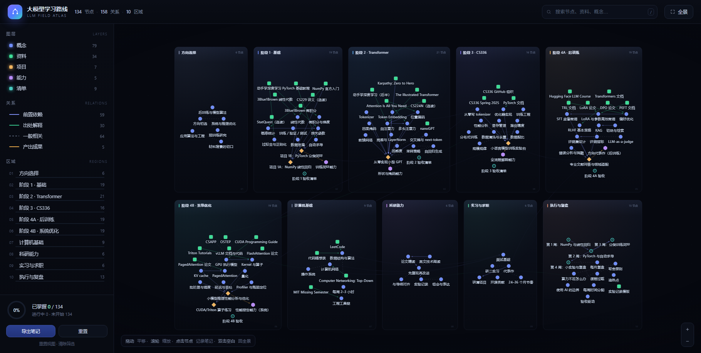

> 在 Obsidian 中查看：在左侧文件列表右键 `大模型学习路线-交互图谱.html` →「在默认应用中打开」，或直接在资源管理器里双击。
>
> 这个 HTML 要和同目录的 `mathjax-tex-svg.js` 放在一起，笔记里的公式才能渲染。

# 大模型学习路线 · 知识图谱

把 `大模型学习路线-跨专业研一到就业.md` 整理成一张可交互的知识地图：**134 个节点 · 158 条关系 · 10 个区域**，覆盖文档里的方向选择、五个学习阶段、计算机基础、科研、求职与执行清单。



## 打开

双击 `大模型学习路线-交互图谱.html`，推荐 Chrome / Edge。

文件夹里的两个文件要放在一起：

- `大模型学习路线-交互图谱.html`：图谱本体
- `mathjax-tex-svg.js`：本地公式渲染器，用来显示笔记里的 LaTeX（没有它时公式会退回源码显示）

不需要联网，不需要安装任何东西。窗口宽度建议 ≥ 1280px。

## 操作

| 操作 | 效果 |
| --- | --- |
| 拖动空白处 | 平移画布 |
| 滚轮 | 以鼠标为中心缩放 |
| 点击节点 | 右侧打开详情：说明、要点、资料链接、关联节点、笔记、学习状态 |
| 搜索框 / `/` | 按标题、描述、标签搜索，回车跳到节点 |
| 左侧图层 | 显示/隐藏 概念、资料、项目、能力、清单 |
| 左侧关系 | 显示/隐藏 前置依赖、出处解释、一般相关、产出成果 |
| 左侧区域 | 点击飞到对应板块（也显示各区域的掌握进度条） |
| 双击区域 | 放大到该区域；双击空白回全景 |
| `F` / 右上「全景」 | 回到全局视图 |

节点形状对应类型：圆点 = 概念，方块 = 资料，菱形 = 项目，六边形 = 能力，圆环 = 清单。
节点右上角的蓝点表示写过笔记；绿色圆环 = 已掌握，橙色半环 = 学习中。

## 笔记：支持 Markdown、代码和公式

节点详情里的「我的笔记」有 **编辑 / 预览** 两个页签：

- **Markdown**：`#` 标题、`**粗体**`、`*斜体*`、`- 列表`、`> 引用`、`` `行内代码` ``、`[链接](url)`、`---` 分隔线；
- **代码块**：三个反引号包起来，支持语言标注，例如：

  ````markdown
  ```python
  scores = q @ k.T / math.sqrt(d_k)
  ```
  ````

- **数学公式**：行内 `$QK^T/\sqrt{d_k}$`，块级 `$$\mathrm{softmax}(QK^\top/\sqrt{d_k})V$$`，也支持 `\(...\)` 和 `\[...\]`；
- 预览用本地 MathJax 渲染成 SVG，离线也能看。

导出时保留的是你写的 Markdown / LaTeX 原文，所以导进 Obsidian 后能继续正常渲染。

## 笔记存在哪里

笔记和学习状态保存在浏览器本地（localStorage），只在这台电脑、这个浏览器里有效。

- **导出笔记**：生成一份 Markdown，带 frontmatter、`[[wikilink]]` 和 `- [x]` 勾选框，可以直接放进 Obsidian 继续写。
- **重置**：清空全部状态和笔记（会二次确认）。

换电脑、换浏览器、清理浏览器数据都会丢失本地记录，重要内容记得定期「导出笔记」。

## 图谱结构

| 区域 | 节点 | 对应文档内容 |
| --- | --- | --- |
| 01 方向选择 | 6 | 第一节：四个方向与材料背景的切口 |
| 02 阶段 1 · 基础 | 19 | 第二节：数学、NumPy、PyTorch、项目 1A/1B |
| 03 阶段 2 · Transformer | 21 | 第三节：注意力、掩码、从零实现小型 GPT |
| 04 阶段 3 · CS336 | 16 | 第四节：tokenizer、训练工程、显存、分布式 |
| 05 阶段 4A · 后训练 | 19 | 第五节 A：SFT、LoRA、RAG、评测与消融 |
| 06 阶段 4B · 系统优化 | 19 | 第五节 B：CUDA、KV cache、vLLM、性能分析 |
| 07 计算机基础 | 9 | 第六节：算法、OS、网络、工具链 |
| 08 科研能力 | 6 | 第六节：论文精读、复现、实验记录 |
| 09 实习与求职 | 6 | 第七节：实习、代表作、面试 |
| 10 执行与复盘 | 13 | 第八～十一节：前四周清单、取舍原则、每月复盘 |

关系类型：前置依赖 59、出处解释 30、一般相关 64、产出成果 5。

## 改内容

所有内容都在 `大模型学习路线-交互图谱.html` 里的三个数组中，改完刷新即可：

- `REGIONS`：区域框（位置、大小、强调色）
- `NODES`：节点（`id / label / type / region / desc / tips / links / tags`）
- `EDGES`：关系（`[起点 id, 终点 id, kind]`，kind 取 `prereq` / `source` / `related` / `produce`）

节点位置由脚本按标签宽度自动排布，不需要手动摆；新增节点后刷新页面会重新布局。

## 说明

- 内容依据你给的文档整理，资料链接均来自文档；课程页面可能随年份调整。
- 图谱用于浏览和记笔记，不替代原文；每阶段的验收标准仍以文档为准。
- 预览图：`preview.png`（全景）、`preview-panel.png`（节点详情与公式预览）。

