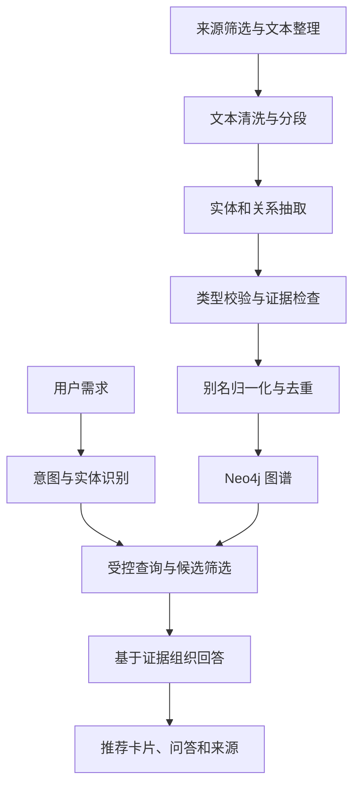

# 杭州旅游智能助手实现方案

> [!abstract] 项目定位
> 长期目标：构建一个懂杭州文化、能够理解游客兴趣、提供有依据的地点推荐，并逐步支持实际行程规划的旅游智能助手。
>
> 近期目标：在 **2026 年 12 月 31 日**前完成一个基于知识图谱的文化旅游推荐与可溯源问答原型，同时交付课程要求的图谱、抽取实验、Schema、代码和说明材料。

## 1. 背景、约束与目标

### 1.1 当前基础和团队情况

- 已理解实体、关系、属性、本体及 ABox／TBox 等概念。
- 按《Python 编程：从入门到实践》第二版练习过 Python，但缺少独立项目经验。
- 小组三人，当前本人兴趣最强，选题和具体分工尚未正式确认。
- 近期采用“本人可以推进核心流程”的工作量设计，同时争取组员负责数据、标注、复核和测试。
- 课程结束后愿意继续投入，因此课程版本是长期产品的第一阶段。

### 1.2 课程要求与对应成果

以下依据课程考核截图整理，并结合 [[课程考核]]；具体提交细则以教师最新要求为准。

| 课程要求 | 本项目的对应成果 |
|---|---|
| 三或四人一组 | 三人分工与实际贡献记录 |
| 主要面向开放域数据 | 采用多来源旅游文化文本；需确认聚焦杭州的选题是否被接受 |
| 深度利用抽取技术 | 实体与关系抽取、证据提取、类型校验、实体归一化及对比实验 |
| 基于 cnSchema 扩展 | cnSchema 复用／映射表、扩展类型和属性定义、实例示例 |
| 贡献开放知识图谱到 OpenKG.cn | 可发布图谱、Schema、数据说明、许可与来源清单，按当前流程提交 |
| 推荐搜索、QA 或挖掘分析应用 | 兴趣驱动的地点推荐、文化问答与证据展示 |

> [!important] 三项前置确认
> 1. “杭州旅游文化”这样的聚焦主题是否满足教师对开放域的要求。公开数据不等于开放域数据。
> 2. 大模型辅助抽取及本方案的实验设计是否满足“深度利用抽取技术”的要求。
> 3. 课程设计的报告、答辩和 OpenKG 提交细则。截图中“8–10 页中文报告”属于课程报告路线，不能自动视为课程设计的同一要求。

### 1.3 建议题目

**《面向杭州文化旅游的知识图谱构建与可溯源智能助手设计》**

实际数据范围先限定为西湖周边及相关文化地点，避免一开始覆盖整个杭州。

## 2. 产品范围与版本划分

### 2.1 第一条核心用户流程

用户输入：“我对苏轼和西湖文化感兴趣，有哪些地方值得了解？”

系统依次完成：

1. 识别兴趣人物或文化主题。
2. 查询图谱中的相关地点及关联关系。
3. 返回最多三个有依据的候选地点，不足三个时不强行补足。
4. 解释推荐理由，展示证据句和来源。
5. 用户追问“第二个地点为什么相关”，系统基于当前候选及证据继续回答。

这是一项验收场景，不预先假定具体关系正确。所有文化事实以实际收集、核查的资料为准。

### 2.2 课程版本：截至 2026-12-31

| 能力 | 实现边界 |
|---|---|
| 地点与主题检索 | 支持地点名称、人物名称和少量人工定义的文化主题 |
| 文化推荐 | 根据关系类型、直接关联和证据完整度筛选候选，不声称已经实现用户个性化学习 |
| 文化问答 | 只回答图谱或检索文本能够支持的问题 |
| 简单追问 | 保存当前候选地点与少量对话上下文，支持指代明确的追问 |
| 来源展示 | 展示关系、证据片段、来源标题和链接 |
| 基础评估 | 抽取指标、错误分析，以及一组应用问题测试 |

第一版不承诺实时交通、营业状态、票价、完整多日行程或最优路线。对这类请求，应清楚说明目前可提供文化地点建议，但尚不能确认可执行安排。

### 2.3 后续版本

| 阶段 | 建议时间窗，可随投入调整 | 目标与退出条件 |
|---|---|---|
| V0.1 课程版 | 2026-11-13—2026-12-31 | 核心推荐、问答、证据流程可运行；完成数据、实验与课程交付 |
| V0.2 行程版 | 2027 年 1—2 月 | 接入坐标、地图和出行时间；能检查时间窗口与时长约束，生成可解释的单日安排 |
| V0.3 持续使用版 | V0.2 稳定后，暂不承诺日期 | 支持用户偏好、行程修改、数据更新、部署和反馈闭环 |

V0.2 先做确定性的路线排序与约束检查，再让模型组织解释。交通耗时和营业状态不能由模型凭空生成；接口条款、费用、限流与可用性需要届时确认。

## 3. 数据与知识建模

### 3.1 初期数据范围

- 原型：5 个地点、5–10 篇文本、约 20 条人工核查关系。
- 课程版目标：15–25 个文化地点、40–80 篇介绍文本，按质量和可用时间调整。
- 候选地点：苏堤、白堤、岳王庙、雷峰塔、西泠印社等。仅作为采样候选，不直接据名称推断人物关系。
- 候选来源：文旅部门、景区、博物馆或文化机构的介绍资料，以及许可明确的开放资料。
- 先人工选取少量材料验证，再决定是否编写采集程序。

对每个来源记录：标题、URL、发布者、采集日期、许可／使用条件、允许公开的内容范围。能公开阅读不代表允许再分发；三元组也不能默认免于来源许可约束。若原文不能随数据发布，需确认允许发布的派生数据范围，并保留内部构建与公开交付的区别。

### 3.2 实体和关系

第一版以地点、人物、作品为核心；事件仅在确有需要且时间允许时加入。

| 类型 | 主要属性 | 建模注意点 |
|---|---|---|
| 地点 Place | 稳定 ID、规范名称、别名、类型、所属区域 | 区分景区与景区内地点，不因名称相近就合并 |
| 人物 Person | 稳定 ID、姓名、别名、简介 | 同名人物要消歧，字号和姓名需核对 |
| 作品 Work | 稳定 ID、名称、作品类型 | 区分作品提及地点与人物到访地点 |
| 事件 Event，可选 | 名称、时间描述、规范化时间、地点 | 原文时间不确定时保留不确定性 |

初步关系：地点位于区域、地点属于景区、人物创作作品、作品提及地点、地点纪念人物、人物参与事件、事件发生于地点。最终保留哪些关系由语料和 cnSchema 核对结果决定，不为凑关系种类而增加定义。

文化主题初期可作为受控标签人工标注。必须标明它是人工分类或算法推断，不能冒充来源文本中的明确事实。

### 3.3 cnSchema 与属性图的关系

Neo4j 使用属性图；它不自动提供 RDF／OWL 的语义或推理能力。本项目需要单独保存 Schema 定义和 cnSchema 映射，应用层实现必要的类型检查。

建立 `schema_mapping.csv`，记录：本地名称、概念定义、cnSchema 对应标识、复用或扩展、主语类型、宾语类型、示例和备注。必须核对 cnSchema 当前文档，不预先猜测现有类与属性名称。

开放交付格式根据 OpenKG 当前要求确认。内部先采用 JSONL／CSV；如果需要 RDF，再根据经过检查的映射导出。

### 3.4 每条事实保留什么

- 主语 ID、关系类型、宾语 ID。
- 来源文档 ID、证据句或文本位置。
- 抽取方法与版本、处理时间。
- 人工审核状态。
- 有必要时保留事实发生时间。

同一关系可能由多份文档支持，应保留多条证据记录。建议抽取结果先以“事实＋证据”的独立 JSONL 记录保存，再导入 Neo4j；初期可在关系上存证据 ID 列表，证据详情独立管理。不要把模型自报的置信度当成经过校准的准确概率。

## 4. 技术实现

### 4.1 总体流程



### 4.2 工具选择

| 组件 | 第一版选择 | 选择理由 |
|---|---|---|
| 数据处理 | Python | 已有基础，能够贯穿整个流程 |
| 原始与中间数据 | UTF-8 文本、JSONL、CSV | 易检查、易复现，先避免复杂数据平台 |
| 抽取 | 一个可用模型接口；保留人工基准 | 能较快建立端到端流程，具体服务按许可、成本及可用性选择 |
| 图数据库 | 本地 Neo4j 或可用的托管实例 | 可视化、Cypher 和 Python 支持较成熟 |
| 界面 | Streamlit | 用 Python 即可实现原型 |
| 配置与协作 | 虚拟环境、环境变量、Git | 保证可运行、可回溯，密钥不提交仓库 |

先使用简单函数调用，不急于引入复杂 Agent 框架、向量数据库或微服务。确实出现图查询无法覆盖的文本检索需求时，再增加全文／向量检索。

### 4.3 查询与问答策略

将用户意图映射到少量明确功能：按人物找地点、查询地点文化背景、查询关联作品、按文化主题筛选地点。

第一版用参数化 Cypher 模板执行查询。模型只负责识别结构化参数和基于结果表达，不直接执行任意生成的数据库语句。图谱没有结果时返回“当前资料未覆盖”，不可把缺失关系解释为现实中不存在关系。

推荐排序先采用透明规则：明确关系优先、来源可追溯优先、按关系类型区分关联强度。规则和权重记录在配置中，不宣称是训练得到的最优推荐。

### 4.4 建议项目结构

```text
hangzhou-travel-assistant/
  README.md
  requirements.txt
  .env.example
  .gitignore
  data/
    raw/                 # 原始文本，按许可决定是否公开
    processed/           # 清洗、抽取及融合结果
    evaluation/          # 标注数据与评估切分
    release/             # 经许可核查的公开交付物
  schema/
    schema.json
    schema_mapping.csv
  src/
    prepare_data.py
    extract.py
    validate.py
    normalize.py
    import_graph.py
    query.py
    answer.py
    evaluate.py
  app.py
  docs/
    annotation_guide.md
    data_card.md
    experiments.md
    contribution_log.md
```

模型调用保存输入、版本和结果缓存，失败可重试，已成功的文本不重复扣费调用。先用约 10 篇文本测量成本，再决定总量。

## 5. 实验与验收

### 5.1 抽取实验

| 方案 | 设置 | 比较目的 |
|---|---|---|
| A 基线 | 固定输出格式，直接抽取实体和关系 | 建立起点 |
| B 改进 | 相同模型，加入关系定义、类型约束和证据要求 | 检验错误关系、类型混乱和无依据输出是否减少 |
| C 后处理分析 | 在 B 上增加别名归一化、去重和校验 | 观察重复实体、合并错误及有效关系数变化 |

保持模型版本、文本输入、主要生成参数和评估规则一致，记录提示词。B 是组合改进，不能据此单独归因某一个组件；有余力时再做去掉单项组件的消融实验。

### 5.2 标注与数据划分

目标约 50–100 个短文本片段，最终数量按标注难度决定。以来源文档为单位划分开发集与测试集，避免同篇内容分散造成泄漏；尽量识别跨来源转载或近重复文本。

先制定标注规则，再标一小批统一口径。开发集用于调试，测试集冻结后用于最终报告。组员至少复核一部分数据并记录分歧；若主要单人完成，应如实说明标注和评估的局限。

指标包括实体与关系的 Precision、Recall、F1，另记录无依据关系比例、类型错误、重复实体和错误合并。事先规定实体名称归一化与关系匹配规则。输出格式通过率只作为工程指标，不能替代抽取质量。

### 5.3 应用测试

准备约 20 个问题，覆盖：按人物推荐、地点介绍、作品关联、简单追问、别名输入、资料不足、超出能力范围。记录检索是否正确、回答是否受证据支持、来源能否打开、响应耗时。

不提前承诺某个 F1 分数；先报告实测结果和错误类型。课程完成标准是流程可复现、评估透明、重要错误有解释，而不是填一个未经验证的高指标。

## 6. 阶段时间规划

所有日期按北京时间，课程截止日期为 **2026-12-31**。按每周约 10–15 小时规划，总工作量约 75–110 小时；这是估算，首次项目调试存在额外开销。每周学习约占四分之一，其余用于实现和验证。

| 时间 | 学习与实现重点 | 必须产出／验收 | 预计个人投入 |
|---|---|---|---|
| 11-13—11-19 | GraphAcademy 基础、Cypher；与组员和教师确认方向；采样文本 | 5 个地点、约 20 条人工核查关系入库；能运行至少 3 类查询 | 10–14 小时 |
| 11-20—11-26 | cnSchema 核对、JSONL、模型调用；建立 Schema 与标注规范 | 5–10 篇文本完成自动抽取、证据保存和入库；跑通首次推荐 | 12–16 小时 |
| 11-27—12-03 | 别名归一化、受控查询、Streamlit；增量整理语料 | 页面返回候选地点及证据，支持一次明确追问；冻结核心功能范围 | 12–16 小时 |
| 12-04—12-10 | 标注与评估、错误分析 | 冻结测试集，完成 A/B 实验；记录失败案例与初步指标 | 12–16 小时 |
| 12-11—12-17 | 完成课程范围数据、问答边界和集成 | 约 20 个应用问题测试；主流程稳定，README 可指导运行 | 10–15 小时 |
| 12-18—12-24 | 许可复核、发布数据、报告、OpenKG 流程 | 数据说明、Schema 映射、实验图表、报告初稿；按实际流程发起提交 | 10–15 小时 |
| 12-25—12-31 | 修复、演示、复现与最终交付 | 完整交付包、演示材料、贡献记录和提交状态记录 | 8–12 小时 |

### 6.1 三个关键检查点

- **11-26：端到端检查。**如果抽取到入库尚未跑通，暂停扩大数据，先排除流程问题。
- **12-03：范围冻结。**如果进度偏慢，优先保留推荐、查询和来源，缩减自由对话和事件建模。
- **12-17：功能冻结。**此后主要处理错误、实验、文档与提交，不新增地图或路线规划。

OpenKG 平台审核或上线时间不完全可控，应提前确认流程。只有实际通过才写“已上线”；若审核待定，保留提交记录并向教师确认验收方式。

## 7. 需要补充的知识与课程

> [!note] 学习原则
> 不重新通读 Python 入门书，不要求完整学完每门课程。每学一块，都用项目里的一个功能验证。以下链接作为资源入口；未实时核验课程当前目录、访问条件、费用及证书政策。

| 优先级与时间 | 知识／资源 | 学习范围 | 学完后的项目练习 |
|---|---|---|---|
| P0，第 1 周 | [Neo4j GraphAcademy](https://graphacademy.neo4j.com/) | 图数据库基础、Cypher、图建模；后续补 Python 驱动 | 导入 20 条关系；按地点查人物和作品 |
| P0，第 1–2 周，按需查阅 | [Python 官方中文教程](https://docs.python.org/zh-cn/3/tutorial/) | JSON、文件、模块、异常、虚拟环境；补接口调用和日志 | 将文本转为统一 JSONL，失败有日志，结果可缓存 |
| P0，第 1 周开始 | [Pro Git 中文版](https://git-scm.com/book/zh/v2) | 仓库、提交、分支、合并、忽略文件 | 保留可运行版本，不提交密钥和无权公开的数据 |
| P0，第 2–4 周选读 | [Stanford CS520：Knowledge Graphs](https://web.stanford.edu/class/cs520/) | 知识获取、图谱构建、知识融合、质量问题 | 写清 Schema、消歧策略和抽取错误分类 |
| P0，第 2 周 | [cnSchema 项目](https://github.com/cnschema/cnschema) | 查阅当前类型、属性和扩展方式 | 完成复用与扩展映射表，不猜类名 |
| P0，第 3 周 | [Streamlit 入门文档](https://docs.streamlit.io/get-started) | 输入组件、状态、表格、缓存和页面组织 | 输入兴趣，显示推荐与证据，并保留简单追问上下文 |
| P1，第 3–5 周 | [DeepLearning.AI：Knowledge Graphs for RAG](https://www.deeplearning.ai/short-courses/knowledge-graphs-rag/) | 图谱检索、证据组织、问答集成 | 让回答依据检索结果生成；检查无结果时的行为 |
| P1，第 4 周 | 信息抽取评估基础，结合 CS520 和标注实践 | P/R/F1、匹配规则、开发／测试划分、错误分析 | 用同一测试集比较两种方法并写出局限 |
| P2，课程之后 | 后端 API、地图服务文档、约束规划、部署 | 按 V0.2 实际选用服务学习 | 单日路线能验证距离、时间窗口和总时长 |

中文理论补充可选《知识图谱：方法、实践与应用》，优先查阅知识表示、抽取和融合部分。暂不投入 CS224W、图神经网络、模型微调和复杂 Agent 框架；将来出现链接预测、学习排序等明确需求时再补。

### 7.1 各阶段知识自查

- [ ] 能解释 Schema 与具体事实的区别，以及属性图与 RDF／OWL 的区别。
- [ ] 能写参数化查询，理解实体唯一标识与去重。
- [ ] 能说明“纪念某人”为什么不能推导成“某人到访”。
- [ ] 能区分文本明确事实、人工主题标签和模型推断。
- [ ] 能解释 Precision、Recall、F1 以及自己的匹配规则。
- [ ] 能找到一条错误回答对应的抽取、融合或查询环节。

## 8. 团队协作与个人推进策略

| 成员角色，待协商 | 主要责任 | 小批次交付方式 |
|---|---|---|
| 本人：核心实现 | Schema、抽取、入库、查询、界面集成 | 每周一个可运行版本和问题清单 |
| 组员 A：数据与标注 | 来源筛选、文本整理、实体关系标注 | 先交 5 篇，核对格式后再扩充 |
| 组员 B：复核与测试 | 独立复核、问题测试、数据说明和演示材料 | 先复核一批关系并记录分歧 |

组员也可以根据能力接手代码模块。所有人撰写自己负责部分的报告，并记录实际贡献。独立复核具有实质价值，不宜完全省略。

若组员未按时完成，优先减少数据规模，保证核心链路与评估；不要默认自己无条件补齐所有扩张需求。选题确定时同步约定代码、数据许可、公开发布和后续个人维护方式。

## 9. 风险与缩减策略

| 风险 | 观察信号 | 对应行动 |
|---|---|---|
| 数据缺少文化关系 | 多篇介绍只有地址和宣传语 | 换采样来源，优先人物与作品相关的文化地点 |
| 不满足开放域要求 | 教师要求多主题或更广覆盖 | 在定题前调整为更广的百科图谱，杭州作为应用场景 |
| 数据不能公开 | 许可缺失或限制派生再分发 | 替换来源或缩小公开数据范围，并确认课程接受方式 |
| 抽取质量不稳定 | 关系无依据、类型混乱 | 收紧 Schema、缩短文本、保留证据、扩大人工检查 |
| 别名误合并 | 景区与子地点混为一体 | 使用稳定 ID 和小型人工映射表，降低自动合并激进程度 |
| 模型费用或接口不稳定 | 重复调用、超时、成本超预期 | 缓存、限制批次、记录失败；先完成小规模测算 |
| 开发进度落后 | 两周后主流程仍未跑通 | 缩减事件、自由对话和数据量，保留模板查询与证据展示 |
| 应用无法可靠规划 | 缺交通／开放信息 | 课程版只做地点建议，下一阶段接入实际数据与约束校验 |

## 10. 最终交付清单

- [ ] 数据来源与许可清单。
- [ ] Schema 定义、cnSchema 映射与扩展说明。
- [ ] 可按授权范围发布的图谱数据及数据说明。
- [ ] 抽取、校验、归一化、入库和评估代码。
- [ ] 模型及提示版本、数据切分、实测指标和错误分析。
- [ ] 推荐、问答与证据展示的可运行应用。
- [ ] README、环境配置示例和复现步骤。
- [ ] 课程设计报告、演示材料和成员贡献记录。
- [ ] OpenKG 实际提交记录与审核状态，不把待审核写成已上线。

## 11. 接下来七天的行动清单

- [ ] 与组员分享此方案，确认兴趣、可用时间和第一个小批次任务。
- [ ] 向教师确认主题范围、抽取方式和交付细则。
- [ ] 完成 GraphAcademy 的基础与 Cypher 入门内容。
- [ ] 建立项目目录、虚拟环境、Git 和配置模板。
- [ ] 为 5 个地点收集 5–10 篇适合使用的文本并登记来源。
- [ ] 人工整理约 20 条有证据的关系，形成第一版 Schema。
- [ ] 用 Python 写入 Neo4j，完成至少三类查询。
- [ ] 记录遇到的问题和实际耗时，据此调整下一周范围。

> [!success] 第一阶段成功的样子
> 用户输入一个杭州文化兴趣，系统返回有资料支撑的地点建议、说明理由，并能回答一次明确追问。你能解释每条知识怎么来的，展示抽取评估，也能在资料不足时清楚地告诉用户。这个版本既能承担课程交付，也能成为长期旅游智能助手的起点。
